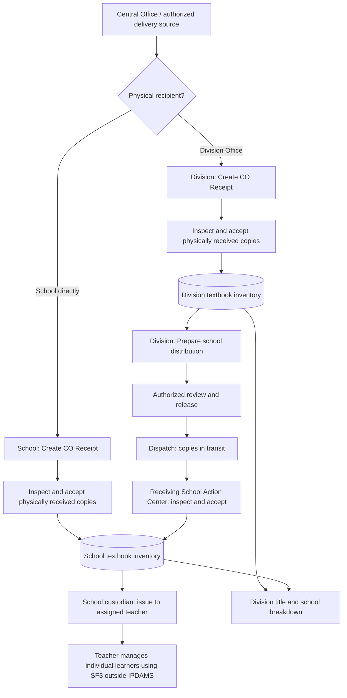

# IPDAMS — Central Office Textbook Receipts and School Distribution

**Designed:** 2026-11-04 · **Status:** approved direction from user, implementation design for next milestone; **NOT installed**.  
**Source baseline:** v0.2.271 ISBN directory and safety gate staged; actual installation version not confirmed.  
**Scope:** central-supplied textbooks/teacher manuals/instructional materials delivered through the Division Office or directly to a school, with subsequent school/teacher accountability.

## 1. Governing rule

The **physical receiving office**, whether the Division Office or an individual school, records a Central Office delivery as a receipt in IPDAMS. The sender is recorded as **DepEd Central Office (external source)** with the real delivery and allocation references. The system does not require a Central Office IPDAMS account or invent a Central Office stock balance. Accepted copies belong to the receiving office's inventory. A school receiving directly from Central Office **does not** credit the Division's stock.

The receiving custodian must first search the shared Book Directory by canonical ISBN (or official LR/resource code for material without ISBN). Matching editions are **reused**, not re-created. New bibliographic entries must pass the catalog steward's uniqueness/review requirements; adding a title is **not** the same operation as adding physical stock.

## 2. Parallel official receipt pathways

### Path A. Central Office → Division Office → Schools

1. Central Office ships or arranges delivery of the textbooks to the Division. Division's appointed custodian creates **Textbooks → Central Office Receipts → New Receipt** with office preselected, official supplier/CO reference, actual arrival date, delivery/packing list and receipt evidence.
2. Search ISBN / official LR code. One record per edition in the shared directory; do not create duplicates per receiving office.
3. Enter expected, physically delivered, accepted serviceable, damaged-on-arrival, rejected/unconfirmed and shortage quantities per line. Authorized inspection/acceptance confirms actual physical counts. Only accepted serviceable copies enter the Division's *available* pool; accepted damaged copies are separately quarantined.
4. The Division creates **Distribute to Schools** allocation from its serviceable, unreserved balance; selects recipient schools within its Division. Authorization precedes dispatch; a draft does not alter stock. On dispatch, the quantity leaves Division available and enters *in transit* exactly once.
5. Each school receives an Action Center task; its appointed school custodian checks documents and physical quantities, accepts serviceable copies and documents any damaged/unreceived copies. Acceptance credits only the receiving school's appropriate condition pool. Unresolved transit and shortages remain visible for reconciliation; no phantom school stock.
6. Division sees every dispatch status, school receipt, discrepancy and immutable source lineage. The school can issue accepted serviceable books to teachers, with signed/verified acknowledgment.

### Path B. Central Office → School directly

1. Central Office delivers to the school. The **school**, not the Division, creates the CO receipt in its school workspace using the same intake screen and validation rules. It selects existing title edition by ISBN or requests a catalog entry.
2. School inspector and appointed custodian verify the delivery; accepted serviceable copies increase **only that school's** available balance, while accepted damaged copies are quarantined. The Division does **not** create a mirroring receipt or dispatch.
3. The Division receives read-only oversight through its authorized consolidated receipts/title breakdown. Its report distinguishes **CO Direct to School** from **CO via Division → School** provenance.
4. The school may issue serviceable books to teachers. An eventual surplus offer to another school uses a **separate Division-authorized inter-school transfer**, not a second CO receipt.

## 3. Required receipt form fields and documents

- **Header:** receiver office auto-bound to logged-in workspace; source = Central Office (external); receipt/date; CO allocation/dispatch reference if available; supplier or delivery agent if applicable; delivery receipt/packing-list number; actual physical receiving custodian and inspector; inspection/acceptance document reference; remarks and evidence attachments.
- **Lines:** shared ISBN/LR-code edition ID; displayed title, grade, subject, edition/publisher; source batch/reference; expected count, delivered count, accepted serviceable, accepted damaged/quarantine, rejected/disputed; computed shortage/overage (never editable synthetic balance); evidence for mismatches.
- **Checks:** every count nonnegative integer; `serviceable + damaged + rejected_or_held = delivered`, `shortage=max(expected-delivered,0)`, `overage=max(delivered-expected,0)`; duplicate official source-delivery reference warnings plus backend idempotency; accepted date cannot predate documented receipt; receiver scope/appointment and independent inspection authorization enforced server side.
- **Statuses:** `DRAFT → SUBMITTED → INSPECTED → ACCEPTED` or `ACCEPTED_WITH_DISCREPANCY`, with legitimate `REJECTED` where applicable. Correct an accepted entry using a separate audited correction/return, never inline edits to the immutable accepted snapshot. An incomplete draft does not change inventory.

## 4. Required distribution form and acceptance

- **Division header:** source office Division, authorized recipient school, allocation purpose/program, date, accountable releasing officer, related CO receipt(s) and documentary authority. Multiple line editions/receipts allowed; issue quantity must not exceed unreserved serviceable stock at commit.
- **Stages:** `DRAFT → APPROVED → DISPATCHED → RECEIVED` or `PARTIALLY_RECEIVED / DISCREPANCY`, with cancellation only before dispatch and proper authority. Signed dispatch and receipt evidence remain linked.
- **School acceptance:** receiving school must accept physically. Individual `accepted_serviceable`, `accepted_damaged`, `returned_to_sender`, and `missing_pending` quantities are reconciled to the dispatch line; no single-side transfer that automatically credits another office.
- **Safety:** lock source lot balances and commitments in stable order; idempotent dispatch and receipt; no negative balance, no duplicate acceptance; school must be active and within the Division; current appointed custodian must act in owning workspace; no silent `SUPER_ADMIN` custodial impersonation. A transfer reserves/debits once, with unresolved copies tracked *in transit/discrepancy*.

## 5. Ownership and reconciliation

For any accepted CO quantity:

`Accepted CO quantity - verified returns - authorized retirement = serviceable physical + damaged/quarantine physical + teacher held + documented in transit + officially open unresolved loss` (adapt to the final ledger's sign conventions and disposition categories).

- **Available:** serviceable physical copies at the office **minus** reserved commitments; not teacher-held, quarantined, in-transit or pending acceptance.
- **Teacher held:** remains part of the school's total inventory but is not available for redistribution.
- **Direct CO school receipt:** increases school total; never increases Division physical holdings.
- **Division → school dispatch:** reduces Division available; becomes one in-transit balance until school accepts; then increases that school's stock. A school's partial receipt must not be overstated.
- **For consolidated reporting:** no double counting of teacher-held or in-transit; historical movements and source docs preserved in their original office.

**Example:** 100 accepted at Division. Dispatch A=40 and B=30. A receives 40, B receives 25 and 5 remains unresolved: Division=30 available, A=40, B=25, in-transit/discrepancy=5. Separately C receives 25 directly from CO: Division still 30, C=25; overall accepted CO supply across offices is 125, with no duplicated CO intake.

## 6. Action Center, screens and permissions

**Division Textbooks:** `Book Directory` · `Central Office Receipts` · `My Division Stock` · `Distribute to Schools` · `Pending School Acceptance` · `Transfers / Surplus Requests` · `Title Breakdown` · `Movement History`.

**School Textbooks:** `Book Directory` · `Central Office Receipts` · `My School Stock` · `Incoming Books / Action Center` · `Teacher Accountability` · `Surplus / Requests` · `Damage & Loss Reports` · `History`.

The school CO-receipt action and Division CO-receipt action **use one shared server workflow**, choosing the receiver only from the current verified office; only the respective appointed receiver and inspector can accept. Division reporting may read authorized school totals but **must not mutate school receipts**. Distribution creation is Division-only; school receipt acceptance is school-only. Grant visibility must not bypass default school inventory protections.

## 7. Later lifecycle (outside this first release)

A school custodian issues accepted books by ISBN/batch and quantity to a **currently assigned teacher** against a signed acknowledgment. Teachers maintain individual student issuance and returns through **SF3 outside IPDAMS**; IPDAMS stores only school/teacher aggregate custody and an SF3 reference. Damage/loss is a reported incident awaiting appropriate review and relief; damaged copies are physically returned to the school custodian and quarantined. No automatic loss write-off or teacher salary deduction. Disposal follows competent authority and documented rules. Surplus offers between schools require Division authorization and reuse dispatch/acceptance.

## 8. Build gates (the next installable milestones)

1. **CO Receipt v1 (both entry points):** finish canonical ISBN duplicate audit/reconciliation, add receipt documents/lines and serviceable/quarantine ledgers, protected creation and acceptance, no legacy generic posting. Validate direct school vs Division receipt and stock conservation. **First needed implementation.**
2. **Division Distribution v1:** source reservations, authorization, dispatch, receiving School Action Center and partial acceptance, linkage to original CO receipt.
3. **Teacher custody + SF3 reference**; then school surplus/transfer; then damage/loss/retirement authority; then richer title-by-school reports.

No live financial postings or automatic procurement/IAR generation from external CO deliveries. Source documents remain authentic and distinct from locally procured school IAR/Purchase Orders. Do not use an unconfirmed predecessor installer version: verify whether v0.2.271 was installed before choosing the next ZIP version gate. Independent database and website backups are required before any first schema-changing release. No extra staging site or paid CI is necessary for synthetic test preparation.

## 9. Source references and review limits

- [DepEd Order No. 14, s. 2012](https://www.deped.gov.ph/2012/02/10/do-14-s-2012-policy-and-guidelines-on-the-proper-distribution-care-recording-retrieval-and-disposal-of-textbooks-txs-with-the-teachers-manuals-tms-and-other-instructional-materials/): distribution, care, recording, retrieval and disposal.
- [DepEd Order No. 62, s. 2010](https://www.deped.gov.ph/2010/05/17/do-62-s-2010-guidelines-for-the-supply-allocation-delivery-and-distribution-of-centrally-procured-instructional-materials-for-priority-schools/): an example of CO-sourced materials delivered via Divisions for onward school distribution, for its specified program.
- [DepEd Order No. 5, s. 2010](https://www.deped.gov.ph/2010/02/05/do-5-s-2010-guidelines-on-inspection-of-deped-deliveries/): inspection of deliveries.

Actual document names, signature authority and current procedural applicability depend on the CO shipment/program and should be confirmed against the particular delivery's official instructions and current property/accounting requirements. This design is an **IPDAMS system flow**, not a claim that all deliveries must use the same government form.
